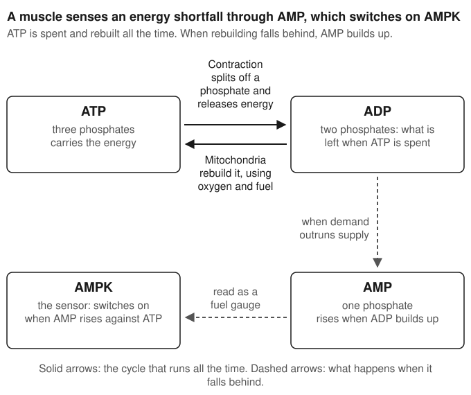

# Chapter 2: How bodies adapt to training

In 1966 five healthy 20-year-old men in Dallas agreed to spend three weeks in bed. Physiologists measured their hearts and their VO₂max before and after, then put them through a training programme and measured them again. The study became one of the best known in exercise science, mostly for how much fitness the men lost while lying down.

Thirty years later the same five men, now 50, came back to the laboratory. Their VO₂max averaged 2.90 litres of oxygen a minute, against 3.30 when they were 20, a fall of 11%. (Those are totals for the whole body, not adjusted for weight like the per-kilogram figures in Chapter 1.) The researchers who retested them concluded that three weeks of bed rest at 20 had done more damage to the men's capacity for physical work than three decades of ageing {shadow @mcguire2001}.

The Dallas study is usually told as a warning about bed rest. It also shows how training works. The body does not hold on to capacity it isn't using: a big heart, a large blood volume and muscles packed with mitochondria all cost energy to maintain, and they are kept only while something keeps demanding them. Training is that demand.

## A session is a disturbance

At rest, a muscle cell keeps its internal chemistry within narrow limits. A ride pushes it outside them, and the cell has sensors that register how far.

The first disturbance is to the energy supply. Muscle contraction is powered by ATP (adenosine triphosphate), the molecule every cell uses to carry energy from the fuel it burns to the work it does. ATP has three phosphate groups, and the energy is released when one is split off. A working muscle uses ATP many times faster than a resting one, and it stores only enough for a few seconds, so it has to keep rebuilding it. Each ATP molecule that is spent leaves behind ADP, with two phosphates, and when ADP builds up some of it is converted to AMP, with one. The ratio of AMP to ATP is the cell's fuel gauge, and an enzyme called AMPK (AMP-activated protein kinase) reads it. When energy demand outruns supply, AMP rises and AMPK switches on.

The second disturbance is calcium. A muscle fibre contracts when a nerve impulse makes it release calcium from internal stores, and relaxes when the calcium is pumped back. A fibre that contracts 90 times a minute for three hours is flooded with calcium again and again, and a second family of enzymes, the calcium-dependent kinases (CaMK), responds to that. The third is mechanical: the fibres are stretched and loaded, and proteins that sense tension respond in their turn [@egan2010]{shadow @eganzierath2013}.

These sensors are kinases, enzymes that work by attaching a phosphate group to other proteins and so changing what those proteins do. Some of their targets act within seconds: AMPK, for example, tells the cell to take up more glucose and burn more fat during the ride itself. Others act on the cell's DNA, and those are the ones that produce training adaptation.

Every muscle cell carries the instructions for every protein the body can make, and at any moment it is using only some of them. To make more of a protein, such as an enzyme inside the mitochondria, the cell first copies the relevant gene into a short-lived molecule called messenger RNA (mRNA). The mRNA travels out of the nucleus and is read by the machinery that assembles proteins. More mRNA for a protein means, some hours later, more of the protein. The signals set off by exercise change which genes are being copied.

So the outline of adaptation is a chain with four links. A session disturbs the cell. Sensors register the disturbance. Genes are switched on, and mRNA is made. Protein follows. Repeat the session often enough and the extra protein accumulates into something that can be seen under a microscope: more mitochondria, more capillaries around each fibre.

## How it works: from one ride to more mitochondria

Much of the signalling from exercise converges on one protein. Its full name is peroxisome proliferator-activated receptor gamma coactivator 1-alpha, which is why everyone calls it PGC-1α. It came out of research on cold, not exercise. In 1998 Bruce Spiegelman's laboratory in Boston was studying how mice keep warm, and found a previously unknown protein in their brown fat, the tissue that burns fuel to make heat. When the mice were put in the cold, the gene for this protein became far more active, in brown fat and in skeletal muscle. When the researchers put the protein into ordinary white fat cells, the cells made more of the enzymes of the mitochondrial respiratory chain and more mitochondrial DNA {shadow @puigserver1998}.

PGC-1α is a co-activator. It doesn't bind to DNA itself. It attaches to the proteins that do, and switches on whole groups of genes together: the ones needed to build a mitochondrion are scattered across the cell's chromosomes, with a few more inside the mitochondrion's own small genome, and something has to coordinate them.

Four years after the discovery, the same laboratory bred mice whose muscles made extra PGC-1α. Muscles that would normally be pale and rich in fast-twitch fibres turned redder. They switched on mitochondrial genes, made proteins typical of slow-twitch (type I) fibres, and when stimulated electrically they resisted fatigue for much longer {shadow @lin2002}. Extra PGC-1α, with no training at all, had produced something that looked like an endurance-trained muscle.

That experiment is why PGC-1α is often called the master regulator of mitochondrial biogenesis, the building of new mitochondria. Exercise activates it through the sensors described above, AMPK and the calcium-dependent kinases among them, and it also raises the amount of PGC-1α the cell makes [@egan2010].

"Master regulator" overstates it. Mice bred with no PGC-1α at all still increased their mitochondrial enzymes when they were trained for five weeks, by about as much as normal mice, according to a Danish study described by Christopher Perry and colleagues [@perry2010]. The cell evidently has other routes to the same result. PGC-1α is the best understood of them and the one most often measured, and that second fact matters later in this chapter, because a great many claims about training rest on measurements of it.

### One study, up close: seven sessions, nine biopsies

Most studies of training take a muscle sample before a programme and another after it. That shows what changed and nothing about the order in which it happened. In 2010 Perry and colleagues at the University of Guelph in Canada sampled the muscle all the way through [@perry2010].

Nine men in their early twenties, active but not in training, did seven interval sessions over about two weeks. Each session was ten 4-minute efforts at about 90% of maximal oxygen uptake, with 2 minutes of rest between them. A biopsy was taken from the thigh before the first session, and then 4 hours and 24 hours after the first, third, fifth and seventh sessions. Each man gave nine pieces of muscle [@perry2010].

Four hours after the first session, the mRNA for PGC-1α had risen more than tenfold. Twenty-four hours after it, the mRNA was back where it had started. The same thing happened after the third session, the fifth and the seventh, with a smaller rise each time. The authors called it a saw-tooth.

The protein behaved differently. PGC-1α protein was 23% above its starting level a day after the first session, and it did not fall back. It kept rising and levelled off at about 40% above the start by the fifth to seventh sessions. The mitochondrial enzymes came later again. The mRNA for citrate synthase, an enzyme commonly used as a marker of how much mitochondrial material a muscle contains, was up 48% after one session, but the activity of the enzyme itself did not rise until after the third session, when it was 17% higher. The third session fell on the fifth day. Another mitochondrial protein, COX-IV, did not increase until after the fifth session [@perry2010].

![What Perry and colleagues found across seven interval sessions. Top: PGC-1α messenger RNA. The first peak and the return to the starting level are measured values; the paper's text gives no figures for the later peaks, only that each was smaller, so their heights here are illustrative, and the dashed grey peaks are sessions with no biopsy. Bottom: PGC-1α protein at the three points the text reports, and the sessions after which two mitochondrial proteins first rose. Drawn from the results in the paper's text [@perry2010].](figures/sawtooth.svg)

The study shows the chain in order, in human muscle: a burst of message after every session, gone within a day, and protein building up underneath from one session to the next. No single session produced the adaptation, and the authors concluded that the gains in protein came from the cumulative effect of the repeated bursts.

The men got fitter over the two weeks, and to keep their heart rates at the target the researchers raised the power from 203 watts in the first session to 239 in the seventh. The sessions were harder in absolute terms and the mRNA response still shrank. The authors suggest this may be part of why progress slows as training goes on: the same relative effort disturbs a trained muscle less. That is their interpretation and they label it as one [@perry2010].

There were nine volunteers and no control group, so nothing rules out an effect of the repeated biopsies themselves. All of them were young untrained men. The training was hard intervals only, for two weeks only. The authors cite one other group that found the same ordering in human muscle. The exact percentages belong to these nine men. {grade B}

## What changes in the muscle

The discovery that endurance training changes the muscle itself is usually dated to 1967, when John Holloszy at Washington University in St Louis trained rats on a treadmill and found that the capacity of their leg-muscle mitochondria to use oxygen had roughly doubled {shadow @holloszy1967}. Until then, the improvement from training had been credited mainly to the heart.

In people, the changes are smaller over the length of a typical study and just as consistent. In a Scandinavian study from 1977, five volunteers cycled for 40 minutes, four times a week, at 80% of VO₂max. After eight weeks the activity of two mitochondrial enzymes in their thigh muscle was about 40% higher, and the density of capillaries, the smallest blood vessels, was 20% higher {shadow @andersen1977}. In a Swiss study in 2015, 16 untrained men trained three or four times a week for six weeks. The volume of mitochondria in their muscle fibres rose by 43% and the number of capillaries per fibre by 18% [@montero2015]. {grade A for the direction of these changes; the sizes vary from study to study}

Take a rider producing 200 watts. That power needs a fixed rate of ATP supply, whatever the rider's fitness. In an untrained muscle, the mitochondria are few, so each has to work at a high fraction of its capacity to meet the demand, and it takes a large disturbance in the cell's chemistry (low ATP, high ADP and AMP) to drive them that hard. That same disturbance accelerates the breakdown of carbohydrate and the production of lactate. With twice the mitochondria, each works at half the rate, the disturbance needed is smaller, more of the fuel is fat, and less lactate is produced at the same 200 watts. This is the explanation Holloszy gave for his own finding, and it is the link to Chapter 1: more mitochondria raise the power at which lactate starts to accumulate, and so the fraction of VO₂max that can be sustained.

More capillaries help in a similar way. They shorten the distance oxygen has to travel from blood to mitochondria and give the blood more time in contact with each fibre.

### Volume or intensity?

David Bishop's group in Melbourne has reviewed the human training studies twice. Their reading is that the amount of mitochondrial material in the muscle tracks the volume of training, the total amount done, while how well the mitochondria work, measured as the rate at which they can use oxygen, tracks the intensity [@granata2018]{shadow @bishop2014}. If that is right, long easy rides and short hard ones are not substitutes: they improve different properties of the same structure. The authors describe these as trends drawn from a small number of studies.

Not every experiment fits. In 2017 Martin Gibala's laboratory in Canada had ten men train one leg with intervals and the other with continuous riding, six sessions over two weeks, with the work done by each leg matched to within a kilojoule per session. Using two legs of the same person removes differences in genes, diet and sleep. Citrate synthase activity ended about a fifth higher in the interval leg {shadow @macinnis2017}. When the total work is the same, in other words, intensity won.

The two findings can both be true. Matching the work forces the comparison onto short sessions, about half an hour here, and nobody doing low-intensity training rides for half an hour. The practical comparison is between the amount of hard riding a person can tolerate in a week and the much larger amount of easy riding they can tolerate, and a single-leg study over two weeks cannot make it. Part II and Part III take up that comparison with the studies that tried. {grade C that volume determines mitochondrial content and intensity determines function; the reviewers themselves call it provisional}

## What changes in the blood and the heart

The blood adapts in two stages. The first is fast. Early in training the volume of plasma, the liquid part of the blood, expands: the kidneys hold on to more sodium and water, and more protein is kept in the bloodstream to hold the water there. A review by Victor Convertino found that for the first two to four weeks nearly all the increase in blood volume is plasma. After that, red cells start to make up a share {shadow @convertino1991}.

More plasma means more blood returning to the heart between beats. The heart fills further, and a fuller heart ejects more with each contraction, a property of heart muscle known as the Frank–Starling mechanism. Stroke volume goes up, and heart rate at any given power comes down. This is one reason a new rider's heart rate at a fixed effort drops early in training, before the heart itself has changed. It is also the adaptation that heat training exploits, as the chapter on heat describes.

The second stage is slower. The number of red blood cells rises over weeks, under the control of the hormone erythropoietin (the chapter on drugs covers that system in detail). In the Swiss study mentioned above, six weeks of training raised red cell volume by 8% and total haemoglobin mass by 6% [@montero2015].

VO₂max had risen by 9% over the six weeks. The men's muscles had more mitochondria and more capillaries, and their blood had more red cells. To find out which of those was responsible, the researchers took blood from each man until his red cell volume was back at its pre-training level, and tested him again. VO₂max fell by 7%. Most of the gain went with the blood, even though every adaptation in the muscle was still in place [@montero2015].

This is direct evidence for the claim in Chapter 1 that oxygen delivery sets VO₂max. It applies to untrained men in their first six weeks, and it should not be stretched further than that. It also doesn't mean the muscle adaptations were wasted. They don't show up in a test of maximal oxygen uptake because they act on something else: how much of that maximum the rider can hold. {grade B}

The heart itself is the slowest of all. In a study published in 2014, Benjamin Levine's group in Dallas, the successors of the bed-rest researchers, took 12 sedentary adults and trained them for a year, with the aim that each would finish a marathon. By the end they were training seven to nine hours a week. Their hearts were scanned by MRI every three months. VO₂max rose from 40 to 49 millilitres per kilogram per minute. The wall of the left ventricle, the main pumping chamber, thickened over the first six months. The chamber itself barely enlarged in that time: its volume was 8% greater at six months, and most of the enlargement came in the second half of the year. After twelve months the hearts had the mass of an elite endurance athlete's, and they were still stiffer, less able to stretch and fill {shadow @arbabzadeh2014}.

The study had no control group, which the authors acknowledge, and twelve people. But the pattern is hard to attribute to anything except the training, and it sets a timescale. The large, compliant heart that Joyner and Coyle identified as the mark of a champion takes more than a year of serious training to build, and the authors raise the possibility that part of it has to be built while the body is still growing. {grade B}

That last point is a suggestion from the authors, and their study could not test it: a heart that is still stiff after one year might simply need five.

The same laboratory later ran a trial that bears on it. Sixty-one sedentary people with an average age of 53 were randomly assigned to two years of supervised training or to a control group, and their hearts were measured with catheters before and after. In the training group VO₂max rose 18%, from 29.0 to 34.4 mL/kg/min, and the left ventricle became measurably less stiff. Neither changed in the controls [@howden2018]. A heart that had been sedentary for five decades could still be made more compliant. The trial did not compare its volunteers with elite athletes, so it doesn't say how close to a champion's heart a late starter can get. {grade B}

If the authors' suggestion about growth is true, it concerns the very top of VO₂max and nothing else. These twelve adults, who had never trained, raised their VO₂max by a fifth in a year, and every muscle and blood adaptation described in this chapter was measured in adults. So the worst case is that someone who starts as an adult never gets a champion's heart, while still getting a great deal fitter.

### Reading the research: a signal is not an adaptation

In 2010 a group in Dublin had eight sedentary men ride twice. On one occasion they rode at 40% of VO₂max and on the other at 80%, in each case until they had burned 400 kilocalories. Three hours after the easy ride, PGC-1α mRNA in their thigh muscle was 3.8 times its resting level. Three hours after the hard ride it was 10.2 times. AMPK was activated immediately after the hard ride and not after the easy one [@egan2010].

It is a careful study, and it is easy to read too much into it. The tempting conclusion is that hard riding builds mitochondria nearly three times as well as easy riding. Results like this are quoted in support of high-intensity training all the time. Nothing in the study measured mitochondria.

Start with what was measured: one messenger molecule, at one moment, after one session. Perry's study showed that this message is gone within a day and shrinks as training proceeds, while the protein it codes for keeps climbing. A snapshot of mRNA at three hours says which session produced the bigger burst. It does not say how much protein is eventually made, and it says nothing about what months of such sessions would do.

Then look at who was studied. The men were sedentary. For someone untrained, 40% of VO₂max is a gentle effort that barely disturbs the muscle. The response of a trained cyclist to a session at their own endurance pace may be quite different.

And look at what was held equal. To match the energy burned, the easy ride lasted 70 minutes and the hard one 36. A cyclist's weekly long ride is not 70 minutes. The comparison a rider cares about, four hours easy against one hour hard, is not the one the study made [@egan2010].

Bishop's group, reviewing this whole field, concluded that the changes seen after single sessions are "not necessarily predictive" of the adaptations seen after training [@granata2018]. The same caution cuts in both directions. Signalling studies are quoted for Zone 2 as readily as for intervals, and in both cases they are evidence about mechanism: they show that a pathway exists and that a session activates it. Whether one way of training makes riders faster than another is a question only a training study can answer, by training people and measuring them. Chapter 4 is about how to read those.

## How fast it comes, how fast it goes

Put the studies in this chapter side by side and a rough order appears. Plasma volume expands within the first two to four weeks. Mitochondrial enzymes rise within three hard sessions. Capillaries and red cells follow over a period of weeks. The heart's walls thicken over months, and its chambers are still enlarging after a year. These figures come from different studies of different people on different programmes, so the order is more reliable than the exact durations.

What happens when training stops was measured in 1984 by Edward Coyle, then working in Holloszy's laboratory. Seven endurance-trained people stopped training completely and were tested 12, 21, 56 and 84 days later [@coyle1984].

![VO₂max after seven trained people stopped training, as a percentage change from their trained value. Drawn from the figures given in Coyle and colleagues' abstract [@coyle1984]; the day-12 test is not shown because its value is not given there.](figures/detraining.svg)

Their VO₂max fell 7% in the first three weeks, and by eight weeks it had settled at 16% below where it began. The early fall came with a drop in stroke volume, which went all the way back to the level of people who had never trained [@coyle1984].

The muscle lost its gains more slowly and only in part. The activity of mitochondrial enzymes fell with a half-time of 12 days, meaning half of what was going to be lost had gone by then, and settled at a level still 50% above untrained people's. The capillaries did not decline at all in 12 weeks. After 84 days without training, these seven still had a VO₂max of 50.8 mL/kg/min, against 43.3 in a comparison group who had never trained [@coyle1984]. {grade B}

For a rider, the useful reading is that the adaptations lost fastest are also the ones regained fastest. Two weeks off the bike costs mainly plasma volume and some mitochondrial enzyme, which the studies above suggest return within a few weeks of riding again. What took years to build, the capillary network and probably the heart's structure, is much more durable. That second sentence is my inference from putting Coyle's findings next to the training studies. No study in this chapter measured the return directly.

> **From the saddle.** When I've been off the bike with an illness, two weeks at most, the first ride back always feels terrible. But I'm always surprised how quickly it comes back, within maybe two or three rides. Sometimes I think the forced rest helps.

## Why the same training gives different results

Everything so far describes averages. The spread around them is wide.

The largest study of it is HERITAGE, run in North America in the 1990s. It put 481 sedentary adults from 98 families through the same 20-week training programme. The average gain in VO₂max was about 400 millilitres a minute. Some people gained more than a litre a minute, and some gained little or nothing [@bouchard1999].

Because whole families took part, the researchers could ask how much of that spread was inherited. The gains varied 2.5 times more between families than within them, and the statistical model put the heritable share of the training response at up to 47%. How much you improve on a given programme is, to a considerable degree, a family trait. All the participants in that analysis were white, which limits how far the figure can be generalised [@bouchard1999]. {grade B}

From results like these came the idea of the non-responder, the person who trains and doesn't improve, and a figure that around one adult in five is one. In 2017 David Montero and Carsten Lundby in Zurich tested whether that is a fixed characteristic of a person [@monterolundby2017]. They split 78 healthy adults into five groups, who did one, two, three, four or five one-hour sessions a week for six weeks. A non-responder was defined as someone whose maximal power in a ramp test changed by less than the test's own measurement error, just under 4%. In the group training one hour a week, 69% were non-responders. At two hours it was 40%, at three hours 29%, and at four and five hours none. The non-responders were then given another six weeks with two more sessions a week. Every one of them improved.

A test of maximal power, repeated on the same person with no training in between, will not give the same number twice, and here the difference could be as much as 4% either way. A person whose result "didn't change" may have improved by 3% and had a bad day on the second test. So some of what gets reported as non-response in any study is measurement noise, and the lower the training dose, the more people's real gains are small enough to be hidden by it [@monterolundby2017].

Taken together, the two studies say that people differ greatly in how much they gain from a given dose, that much of the difference is inherited, and that in healthy adults at these doses a failure to improve was a matter of too little training, not of a body that can't adapt. They were both done in untrained people. Whether a trained cyclist who has stopped improving on ten hours a week would improve on twelve is a different question, and neither study answers it. {grade B}

## What this means for training

The signal comes from the tissue that was disturbed. A muscle fibre that wasn't recruited during a session received no calcium flood and no energy shortfall, and it has no reason to change. This is the biology behind the old coaching principle of specificity, and it is why the question in Chapter 1, which part of the model does this session change, has a physical answer: the part it stressed.

Adaptation is cumulative. In Perry's study the message from each session was gone within a day, and the proteins rose in steps across sessions. The mechanism favours training that can be repeated over training that can't, and a session that leaves a rider unable to train properly for four days has to be worth four days of bursts. That is an argument from mechanism, and it should be weighed as one.

The same session becomes a smaller stimulus as you adapt to it. In Perry's volunteers that showed within two weeks, even as the power went up. A plan that never changes will stop producing change, and how to progress, by adding volume or adding intensity, is the subject of much of the rest of this book.

The parts of the system keep different time. A new rider's early gains are largely plasma volume and muscle enzymes, which arrive in weeks and leave in weeks. Red cells take longer. The heart takes years. A training block of six weeks, which is the length of most of the studies this book relies on, is long enough to see the fast adaptations and too short to see the slow ones. When a six-week trial finds that one method beats another, it has compared them on the adaptations that arrive quickly. Keep that in mind in every chapter that follows, because the case for years of steady volume rests largely on the adaptations that six-week trials cannot see.
