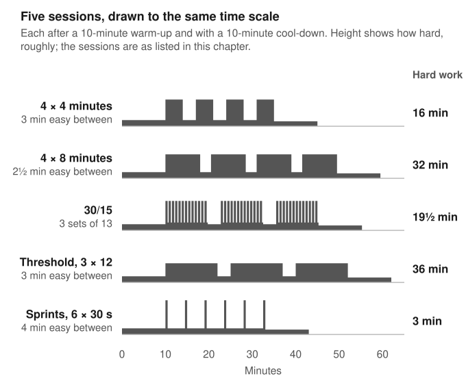

# Chapter 12: Designing intervals

In 2013 Stephen Seiler's group in Kristiansand published a trial in 35 cyclists who were very like the readers of this book [@seiler2013]. They were recreational riders, about 52 mL/kg/min of VO₂peak, who had been training about six hours a week with one or two interval sessions in it. For seven weeks, three groups did two interval sessions a week of 4 × 4, 4 × 8 or 4 × 16 minutes, each ridden as hard as the rider could sustain for that session, and a fourth group rode only easy. The 4 × 8 group improved twice as much as any other. The 4 × 4 group, whose intervals ran at the highest heart rate and felt harder than the 4 × 8s, improved by 5.5%, little more than the 4.2% of the group that rode only easy.

There is no single best interval session, and the claims made for particular ones are mostly larger than the trials behind them. What the trials do support is a pattern. In trained cyclists the sessions that let a rider pile up the most work close to the top of what they can sustain, whether as intervals of four to eight minutes or as 30/15s, beat both shorter, harder intervals and longer, easier ones [@seiler2013; @ronnestad2015b]. Long intervals beat all-out sprints for time-trial performance, and sprints run all-out carry a risk of injury [@rosenblat2020; @helgerud2023]. The order in which the sessions come across the weeks made no difference in the largest trial [@sylta2016]. So the practical choices are fewer than the arguments suggest: pick one or two formats you will ride hard, ride every set at the highest effort you can hold for all of it, and progress by adding work at that effort. {grade B}

## What a session is made of

An interval session is defined by more numbers than its name suggests. A widely used review counts up to nine: the intensity and length of the work periods, the intensity and length of the recoveries, the type of exercise, the number of repetitions, the number of sets, and the length and intensity of the rest between sets [@buchheit2013]. Most arguments about intervals change one of these and leave the reader to assume the others were equal.

There is a tenth that matters as much as any of them: how hard the session was actually ridden. Trials prescribe intensity in one of two ways. Either every rider works at a fixed share of a tested power, which makes the sessions comparable on paper but makes some of them much harder than others in practice, or every rider goes as hard as they can sustain for the whole set, which matches the sessions for effort and lets the power fall where it will. Most of the trials in this chapter used the second method, which is also what riders do on the road. Chapter 11 showed what the choice can do: two sessions that differed by more than two to one in time near VO₂max at fixed powers were almost level when both were ridden all-out {shadow @appelhans2025}.

### One study, up close: four ways to spend two sessions a week

::: trial
Aim: To compare three seven-week interval programmes that differed in the length of the work periods but were matched for effort, in trained recreational cyclists.
Design: Randomised trial lasting seven weeks. 35 cyclists, 29 men and 6 women, with a VO₂peak of 52 mL/kg/min, who had trained about 6 hours a week, with about one and a half interval sessions, for the two months before. Every interval session was ridden at the highest intensity the rider could sustain for it [@seiler2013].
| | 4 × 4 minutes | 4 × 8 minutes | 4 × 16 minutes | Easy only
| Riders | 9 | 9 | 9 | 8
| Each week | Two interval sessions, plus two or three easy rides | Two interval sessions, plus two or three easy rides | Two interval sessions, plus two or three easy rides | Four to six easy rides
| Work in each interval session | 16 minutes | 32 minutes | 64 minutes | None
| Heart rate in the intervals | 94% of peak | 90% of peak | 88% of peak | Not applicable
| Blood lactate in the intervals | 13.2 mmol/L | 9.6 mmol/L | 4.9 mmol/L | Not applicable
-- After seven weeks
| Overall gain in VO₂peak, power at VO₂peak and power at a lactate of 4 mmol/L | 5.5% | 11.4% | 5.6% | 4.2%
~ The 4 × 8 group improved significantly more than each of the other three.
Authors' conclusion: Intensity and accumulated duration interact. Accumulating 32 minutes of work at about 90% of maximum heart rate gave greater gains than accumulating 16 minutes at about 95%, although it felt easier.
:::

The heart rates and lactates show what effort-matching did. Asked to ride as hard as they could sustain, the 4 × 4 riders worked near their maximum heart rate and built up 13.2 mmol/L of lactate, the 4 × 16 riders settled at a level between the thresholds, and the 4 × 8 riders landed in between, close enough to the top to be very hard and long enough to double the work of the 4 × 4 session [@seiler2013]. It was neither the hardest session nor the longest that won.

The trial has limits that a reader of only the abstract cannot see past. Each group had nine riders, the programme lasted seven weeks, and the abstract gives a single figure combining three measures rather than each measure separately, so I can't say whether the 4 × 8 advantage was in VO₂peak, in threshold power or in both. The 4.2% gain in the easy-only group is a reminder that seven weeks of riding more than before will improve a rider whatever the sessions [@seiler2013]. But its central finding has a clear reading for a rider with two hard sessions a week: doubling the work at a slightly lower intensity did more than squeezing half the work in at the very top.

## Long intervals

Four to eight minutes is the oldest and best-tested range. The Trondheim group's 4 × 4 minutes, at 90% to 95% of maximum heart rate with three minutes of easy recovery, has been used in heart patients as well as athletes [@hatle2014]. In their 2007 trial, 40 moderately trained men trained three times a week for eight weeks, with every group doing the same amount of work. The 4 × 4 programme raised VO₂max by 7.2% and a 15-second-on, 15-second-off programme by 5.5%, while continuous training at 70% or 85% of maximum heart rate did less [@helgerud2007].

The Trondheim group's intervals made their name in a very different population. In 2007 the group randomised 27 patients with heart failure after a heart attack, with an average age of 75.5 and a VO₂peak of 13 mL/kg/min, to three sessions a week for twelve weeks of either intervals at 95% of peak heart rate or continuous exercise at 70% {shadow @wisloff2007}. Peak oxygen uptake rose 46% after the intervals and 14% after the continuous training, and only the interval group's hearts became smaller and pumped a larger share of their contents with each beat. Intervals that some cyclists think of as brutal were being prescribed to people in their seventies with failing hearts. Hard is relative to the person.

In trained cyclists, adding long intervals to a base of easy riding improves performance quickly. In 1996 eight competitive South African cyclists, riding about 300 km a week, replaced 15% of it with six sessions over four weeks of six to eight 5-minute efforts at 80% of their peak power. Their 40 km time trial fell from 56.4 to 54.4 minutes, and the power they held in it rose from 301 to 326 W {shadow @lindsay1996}. Three years later the same group gave 20 cyclists six sessions over three weeks of one of five session types, from 12 × 30 seconds at 175% of peak power to 4 × 8 minutes at 80%. The time trial improved most after 8 × 4 minutes at 85%, by 2.8%, and after the 30-second efforts, by 2.4%, while 60-second efforts at 100% and 8-minute efforts at 80% did not produce significant gains {shadow @stepto1999}. The authors suggested that efforts close to race pace and efforts far above it may work through different mechanisms.

The largest trial of long intervals in cyclists, published in 2016, put 63 riders with a VO₂peak of about 61 through 24 sessions in 12 weeks: 4 × 16, 4 × 8 and 4 × 4 minutes, all as maximal efforts for the session, arranged in three different orders [@sylta2016]. Every group improved its 40-minute power, peak power and VO₂peak by 5% to 10%, and the order made no difference at all, either to the averages or to how many riders responded strongly. Effort-matching again set the intensities: the riders' lactate averaged 4.7, 9.2 and 12.7 mmol/L in the three sessions.

Across sports the middle of the range keeps doing well. A 2025 analysis of 51 studies in 1,261 athletes, many of them runners and team-sport players, found that the effect of interval training on VO₂max rose with the length of the work bouts up to about 140 seconds and then fell away [@yang2025]. That is a statistical fit across very different studies rather than a rule, and it sits comfortably beside Seiler's runners, who reached their highest oxygen uptake in 4-minute repeats when they set their own pace [@seiler2004].

## Short intervals: 30/15

The session called 30/15 is three sets of 13 repetitions of 30 seconds hard and 15 seconds easy, with three minutes between sets [@ronnestad2020]. That is 19.5 minutes of hard work in about 35 minutes. Chapter 11 explained the idea: the recoveries are too short for oxygen uptake to fall far, so the rider stays near VO₂max at a power that feels more manageable than a long interval.

Two trials from Bent Rønnestad's group in Norway put it against effort-matched sessions of 4 × 5 minutes with two and a half minutes of recovery. In 2015, 16 cyclists did two sessions a week for ten weeks among their easy training, with the same volumes of hard and easy riding in both groups. VO₂max rose 8.7% in the 30/15 group against 2.6% in the long-interval group, and every performance measure, from 30-second to 40-minute power, moved in favour of the short intervals by a moderate to large amount [@ronnestad2015b]. In 2020 the same comparison in 18 elite cyclists, with a VO₂max of 73, ran for three weeks at three sessions a week. VO₂max did not differ between the groups, but the 30/15 group's peak power rose 3.7% against a fall of 0.3%, and its 20-minute power rose 4.7% against a fall of 1.4% [@ronnestad2020].

Both trials are small, both come from the group that designed the session, and both compared it with long intervals ridden at an even effort chosen by the rider. Long intervals are hard to pace, and the study in Chapter 11 in which both sessions were ridden all-out found almost no difference in time near VO₂max between them {shadow @appelhans2025}. The fairest reading is that 30/15s make it easier to do a large dose of work near the top, which is a real advantage for anyone who struggles to hold a hard long interval, and that a well-paced long-interval session may do much the same. {grade B}

## Threshold intervals

Between the long intervals of this chapter and the easy riding of Part II lies the band that Chapter 5 called "between the thresholds", and many amateurs spend much of their training in it. Intervals there, typically 8 to 20 minutes just below the second threshold, are less intense than anything above and easier to recover from: a single session took 24 to 48 hours of the heart's autonomic recovery in the review Chapter 13 describes, against 48 hours or more after harder intervals {shadow @stanley2013}.

In the trials they did less for VO₂max than harder sessions and more for the share of it a rider can sustain. Seiler's 4 × 16-minute group, which settled at a lactate of 4.9 mmol/L, gained 5.6%, the same as the 4 × 4 group and half as much as the 4 × 8s [@seiler2013]. In Stöggl and Sperlich's four-programme trial in Chapter 8, the group that did most of its hard work at threshold showed no significant change in VO₂peak and gained only 1.4% in power at a lactate of 4 mmol/L {shadow @stoggl2014}. On the other side, the elite skiers in Chapter 13's two-against-four trial did nothing but threshold intervals, 136 minutes a week, and the group that did them in two long sessions raised the share of VO₂max they could hold at threshold from 80.7% to 85.4% and became more economical {shadow @tonnessen2020}. The Norwegian runners described in Chapter 8 build their week around three or four lactate-controlled threshold sessions {shadow @casado2023}.

The pattern is consistent with what Chapter 1's model would predict. Threshold work trains the fraction of VO₂max a rider can sustain, and work near VO₂max trains the ceiling itself. A rider whose VO₂max is already high relative to their threshold has more to gain from the first; one whose ceiling is low has more to gain from the second. For most amateurs on six to ten hours, who have one or two hard sessions to spend, the trials favour giving at least one of them to intervals near the top. {grade C}

## Sprints

Sprint interval training usually means repeated efforts of about 30 seconds, all-out, with three or four minutes of rest. Its appeal is time. In 2006 Martin Gibala's group in Canada found that sixteen active young men gained as much in a time trial and in their muscles' oxidative capacity from six sessions of sprints over two weeks, about two and a half hours of training in all, as from about ten and a half hours of continuous riding {shadow @gibala2006}. Across 16 trials in young people, sprint training raised VO₂max by about 8%, the same as continuous training [@gist2014].

For a rider who already trains, the comparison that matters is with long intervals. A 2020 analysis of six trials in moderately trained people that compared the two found no overall difference in time-trial performance, but long intervals of four minutes or more beat sprints by 2%, and they raised maximal aerobic power more [@rosenblat2020]. A 2023 trial in 81 well-trained women, running, was starker. After eight weeks at three sessions a week, only 4 × 4 minutes raised VO₂max, by 7.3%; two sprint protocols raised anaerobic capacity instead and improved a 300 m sprint more [@helgerud2023]. Every group got faster over 3,000 m. And the 10 × 30-second all-out sprints caused eight injuries, six of them hamstring strains, each bad enough to stop training for at least a week. The other two protocols caused none.

Sprints raise VO₂max in untrained people, improve sprinting, and save time. For a trained rider aiming at long efforts they are the weaker choice, and run all-out they are the riskier one. That trial was on a treadmill, and I found no comparable count of injuries from sprinting on a bike. {grade B}

## How hard

Every successful trial in this chapter asked riders for the hardest effort they could sustain for the session, and two self-paced studies of runners describe what that feels like. When well-trained runners chose their own pace for repeats of one to six minutes, they ended every session at about 17 on the 6-to-20 scale, very hard, whatever the length of the repeats, and their lactate was similar across all of them [@seiler2004]. The pace adjusted to the length; the effort did not.

That gives a practical rule. Start each set at the highest power you believe you can hold for all of it, expect the last repetition to be the hardest, and if you finish with something left, raise the power next time. Long efforts can be made to give more for the same effort by building surges into them: in Chapter 11's study, mixing harder and easier sections within each work interval added time near VO₂max without making the session feel any harder {shadow @bossi2020}.

## Fixed power or all-out

Smart trainers can hold a set power whatever the rider's cadence, and many riders do their intervals that way, typing in a power and letting the trainer enforce it. That is a fixed-power session in the sense of the trials, and the study in Chapter 11 that compared fixed and self-paced versions of the same two sessions found that every measure it took, from oxygen uptake to power, was higher when the riders chose their own pace and went as hard as they could {shadow @appelhans2025}. The 6 × 5-minute session at fixed powers gave three minutes above 90% of VO₂max; ridden all-out, it gave seventeen.

Part of that gap may come from the particular powers the researchers chose. But the same thing happens to a rider who sets a power from an old test, or a cautious one. A fixed power is a ceiling on the session as well as a floor. The remedy is not to abandon the trainer's fixed mode, which makes the efforts repeatable and the recoveries genuinely easy, but to set the power from recent efforts, raise it when a session ends with something left, and accept that the last repetition should be very hard. {grade C}

## What each session does

The sessions are not interchangeable even when they raise VO₂max by similar amounts. In the women's trial, 4 × 4 minutes raised VO₂max and the sprints raised anaerobic capacity, the energy that can be released without oxygen, and improved a 300 m sprint more [@helgerud2023]. In Stepto's cyclists, the two sessions that improved a 40 km time trial were the one closest to race pace and the one far above it, and the authors suggested they worked by different routes {shadow @stepto1999}. Threshold sessions moved the fraction of VO₂max that could be sustained and the oxygen cost of moving, more than VO₂max itself {shadow @tonnessen2020}.

For a rider whose events last an hour or more, which covers most of the readers of this book, that argues for intervals of four minutes and longer as the core, with 30/15s as an alternative way to the same place and threshold sessions as a cheaper complement [@rosenblat2020]. Sprints train something most of those riders rarely need. A rider who races criteriums, or who wants to win the sprint for the village sign, has a reason to include them that the VO₂max trials do not capture.

## Recoveries and warm-up

The recoveries between efforts get less attention than the efforts, and the evidence suggests they deserve less. When nine well-trained runners did 6 × 4 minutes as hard as they could with recoveries of one, two or four minutes, the length of the rest made little difference to how fast they ran, how much oxygen they used or how hard it felt. Left to choose, they rested for about two minutes [@seiler2005]. The long-interval sessions in the trials used two and a half to three minutes [@ronnestad2020; @hatle2014]. Within that range, a rider can take whatever lets the next effort be as hard as the last.

The research sessions began with a warm-up of about ten minutes [@hatle2014], and a review of running studies recommended ten to fifteen minutes at an easy pace with no long gap before the first effort {shadow @midgley2006}. I found nothing to suggest that a longer one adds anything.

## Order and variety

The 63 riders who did the same three sessions in three different orders over twelve weeks all improved by the same amount [@sylta2016]. Nothing in the evidence says that a block of long intervals must come before a block of short ones, or the reverse. Variety has other uses. A session a rider looks forward to gets ridden harder, and a rider preparing for long climbs or time trials has reason to keep long intervals in the mix, since those were the sessions that beat sprints on time-trial performance [@rosenblat2020]. Those are reasons of tolerance and specificity, not evidence that variety itself adds anything.

## The sessions, in brief

These are the sessions the trials in this chapter used, as a rider might ride them. Each assumes a warm-up of about ten minutes of easy riding with a few short pick-ups, and an easy spin afterwards.

1. **4 × 4 minutes,** with 3 minutes of easy riding between. Ridden as hard as can be sustained for all four, which in the Trondheim trials meant 90% to 95% of maximum heart rate [@hatle2014]. Sixteen minutes of hard work; the shortest of the long sessions.
2. **4 × 8 minutes,** with 2 to 3 minutes between, about what Seiler's runners chose for themselves [@seiler2005]. The session that beat both 4 × 4 and 4 × 16 in recreational cyclists, ridden at about 90% of peak heart rate [@seiler2013]. Thirty-two minutes of hard work. A rider who finds 4 × 8 comfortable can add a fifth repetition, as in the 22 cyclists of Chapter 11 {shadow @odden2024}.
3. **30/15:** three sets of 13 × 30 seconds hard and 15 seconds easy, 3 minutes between sets [@ronnestad2020]. The 30-second efforts are harder than a long interval and the 15 seconds are easy pedalling, not rest. Two sets is a reasonable start.
4. **Threshold intervals:** for example 3 × 12 or 2 × 20 minutes just below the second threshold, with 3 minutes between. Less intense, cheaper to recover from, and better for the fraction of VO₂max a rider can sustain than for VO₂max itself {shadow @tonnessen2020}.
5. **Sprint intervals:** 4 to 6 × 30 seconds all-out with 4 minutes of easy riding between. Useful for sprinting and for a rider short of time; the weaker choice for long efforts [@rosenblat2020].

## Women and men

Most interval trials are of men, and the few direct comparisons suggest that the sessions work the same way in women. In the study in Chapter 11 that measured 11 women and 8 men, 30/15s gave more time near VO₂max than steady intervals in both, with no difference between the sexes {shadow @urianstad2024}. The 4 × 4 trial in well-trained women raised VO₂max by 7.3%, much as in men, although one sprint protocol that had raised it in men did not in women, and the all-out sprints injured more women than the same protocol had injured men [@helgerud2023]. Chapter 19 returns to women's training.

## For a rider on six to ten hours

The trials suggest a short list. A long-interval session of four to eight minutes per effort, with enough repetitions to add up to about half an hour of hard work, is the best-tested session for a rider of this kind, and Seiler's recreational cyclists suggest erring towards the longer end. A 30/15 session is a good second format, especially for anyone who finds long intervals hard to ride well. Sprints have a place for sprinting and are not needed for the rest.

Ride every session at the hardest effort you can sustain to the end, judge it by power and effort rather than heart rate, and when a session becomes comfortable, add a repetition before adding power. Keep the easy riding easy, because the trials that produced these gains surrounded the hard sessions with it. How many hard sessions a week can do their work is the next chapter's question. {grade B for the sessions; grade C for the advice on progression}