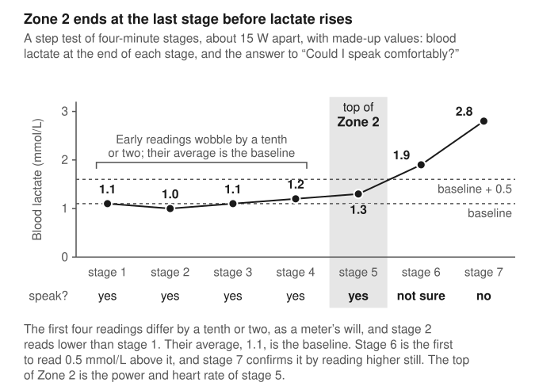

# Chapter 6: Finding your zones

The top of Zone 2 is the first lactate threshold. Muscle makes lactate all the time and the body clears it all the time, and the level in the blood is the balance between the two {shadow @brooks2018}. During easy riding the balance holds near its baseline, around 1 mmol/L in most people. At some power, different for every rider, production begins to outrun clearance and the level steps up. That power, and the heart rate that goes with it, is the first lactate threshold. Riding below it is easy in the sense this book uses the word, and Zone 2 is the band immediately beneath it.

Most riders have never had it measured. They ride to a heart-rate zone that a watch worked out from their age, or a power zone that an app worked out from a 20-minute test, and both are guesses at where the lactate threshold probably lies. The threshold is the target. A lactate test measures it, and everything else (a talk test, a chest strap, a percentage of maximum heart rate) is a stand-in whose worth depends on how closely it tracks the blood.

## Why the boundary matters

Below the first lactate threshold a ride settles. Within a few minutes of a change in power, oxygen uptake, heart rate and lactate level off and stay level. Above it, as Chapter 5 described, the oxygen cost of holding the same power creeps upward for many minutes, because the muscle is tiring and calling on less efficient fibres {shadow @jones2011}.

How long the effort can last changes as well. In the Exeter experiment of Chapter 5, men riding 20 W below their first threshold lasted three and a half hours, and stopped when the glycogen in their muscles had nearly run out. Between the thresholds they lasted 43 minutes {shadow @black2017}.

The cost afterwards also changes. In 2007 Stephen Seiler and colleagues had nine highly trained runners do four sessions on separate days: an hour below the first threshold, two hours below it, an hour that included 30 minutes between the thresholds, and an hour of hard intervals above the second. After each session the runners lay down, and for four hours the researchers followed their heart rate variability, a marker of how far the nervous control of the heart has been disturbed. After the easy sessions it was back to normal within 5 to 10 minutes, and two hours had cost no more than one. After the session between the thresholds it took about 30 minutes, and after the hard intervals it took the same 30 minutes. The authors called the first threshold a "binary" one for recovery: what counted was which side of it the session had been on [@seiler2007]. {grade B}

That is nine runners and one marker of recovery, and the boundary in that study was found from breathing. It is still the clearest evidence for why the top edge of Zone 2 matters. Below it, training time is cheap: the effort settles, it can go on for hours, and it leaves little to recover from. A rider who drifts across the threshold is paying a price that the session's label does not show.

Zones are a way of knowing which side of a boundary you are on. The body has two such boundaries, and the five or seven zones of a watch or an app are subdivisions of the three domains they create. The 2025 panel expected much the same adaptations a little above Zone 2 and a little below it [@sitko2025]. The case for finding the threshold rests on what it costs to cross it.

## Why lactate

The 2025 panel placed Zone 2 immediately below "the first lactate or ventilatory threshold" and left the choice between the two open [@sitko2025]. This book makes the choice. The top of Zone 2 is the last intensity before blood lactate rises 0.5 mmol/L above the rider's own baseline, in a test with stages of at least four minutes. The breathing threshold, and every other method in this chapter, is treated as a way of estimating that point.

The first reason is that lactate is what the argument for Zone 2 was built on. The case made on podcasts descends from work such as a 2018 paper by Iñigo San-Millán and George Brooks, which measured blood lactate and fat burning during exercise in professional endurance athletes, moderately active people and patients with metabolic syndrome. The professionals burned more fat and carried less lactate, and within each group the two measures moved in opposite directions, with correlations stronger than −0.9. The authors proposed blood lactate as an indirect reading of how well a person's mitochondria are working [@sanmillan2018]. If the advice is to ride at the highest intensity that keeps lactate down, then the way to know you are following it is to measure lactate.

The second reason is that a rider can measure it. The first ventilatory threshold needs a mask, a gas analyser and somebody to read the result, and readers differ. In 1983 four exercise physiologists, working independently, marked the threshold on the breathing data from eight people's tests, and for a given person their answers spanned 16% on average {shadow @yeh1983}. A lactate test needs a drop of blood and a meter.

The third is the form of the rule. The Zone 2 of the podcasts is often given as a fixed figure, a lactate below 2 mmol/L {shadow @storoschuk2025}. Baselines differ between people. In the 50 cyclists of Chapter 5, 2.0 mmol/L arrived at 211 W on average, 12 W beyond the first rise, and nine of the riders never recorded a value below 1.5 at any power [@meixner2025]. Handheld meters also tend to read lower than laboratory analysers [@tannerrk2010]{shadow @bonaventura2015}. A meter that reads low delays a fixed 2.0 and sets the zone too high, and it should make little difference to a rise measured against the same meter's baseline.

No study I have read shows the lactate threshold to be the better boundary of the two. A 2020 review of every common method found some evidence for both the first lactate threshold and the first ventilatory threshold as the lower boundary [@jamnick2020]. In the one study here that tested the same cyclists twice, the breathing threshold was slightly the more repeatable, with a standard deviation of 13 W in the retest differences against 19 W for the lactate threshold [@pallares2016]. The two do not always coincide. In three studies of trained cyclists that measured both, the lactate threshold came out level with the breathing threshold, 14 W above it and 24 W above it [@meixner2025; @pallares2016; @olieslagers2026]. And nobody has run the trial that would settle the matter, with one group training to a ceiling set by lactate and another to a ceiling set by breathing. The choice of lactate is made on lineage and practicality. {grade C}

The definition also holds only for a test of the right kind. Lactate takes time to pass from muscle into blood, so in a test that climbs quickly the blood lags behind the legs. In a study that raised the power by 25 W every minute, a rise of 0.5 mmol/L above baseline did not appear until 260 W, level with those riders' maximal lactate steady state at 255 W. In that test the rule found the second threshold [@pallares2016]. In a study with stages of three to ten minutes, the same rise appeared 30 to 40 W below the maximal lactate steady state, and moved by only 10 W between the shortest stages and the longest {shadow @jamnick2018}. The rule needs stages of several minutes, and this book uses four.

## Measuring it

A laboratory lactate test is a step test. The rider starts easy and the power goes up every few minutes. At the end of each stage a drop of blood is taken from an earlobe or a fingertip and read on an analyser, and the values are plotted against power. For the first several stages they stay close to level, and then they begin to climb. That early level is the baseline, and the first threshold is read where the curve passes 0.5 mmol/L above it, the rule used in the Würzburg and Leuven studies [@meixner2025; @olieslagers2026].

The same test can be done at home with a handheld meter, test strips and the kind of spring-loaded lancet that people with diabetes use. When such meters were checked against laboratory analysers, the typical error on repeated readings of the same blood at low concentrations ran from 0.1 mmol/L for the best of three meters to 0.5 for the worst [@tannerrk2010], and five models tested later were generally within 0.5 {shadow @bonaventura2015}. Against a rise of 0.5 that is not a comfortable margin, so a single high reading should not be believed until the next stage confirms it. The Leuven laboratory described below took a second sample whenever the first rise appeared, for the same reason [@olieslagers2026].

The meter's error also bears on what to call the baseline. The papers that use the rule do not agree on it. One averaged the readings of the early stages [@pallares2016], the Würzburg group's label for its baseline points to the lowest reading of the test [@meixner2025], and others do not say [@olieslagers2026]{shadow @jamnick2018}. This book takes the average of the early stages, because one stray low reading moves an average less than it moves a minimum. An average is never lower than the minimum, so on some curves this places the threshold a stage later than the lowest-reading version would. Early readings that differ by a tenth or two, or a second stage that reads lower than the first, are within the error of the meter and no reason to start again.

Technique matters as much as the meter. Sweat contains lactate, and a drop of blood that picks some up from the skin will read high. The skin is washed, dried and wiped before each sample, and the first drop is discarded. These are standard laboratory habits, and I have no figures for how much each one matters at home.

Even in a laboratory the answer moves from one test to the next. Fourteen trained cyclists did the same test twice. Their lactate threshold shifted by 2 W on average, and the differences had a standard deviation of 19 W, so for about a third of the riders the second test put the threshold more than 19 W from the first [@pallares2016]. That test sampled blood only every 50 W, which will have widened the scatter. One test fixes the threshold to within perhaps 10 or 20 W, and a second on another day is worth the strips.

The test gives two numbers to ride by: the power at the threshold and the heart rate at it.

> **From the saddle.** I'm too squeamish for a home lactate test. I wish I could do one, and that's why proxies are good for me. I set my own Zone 2 from a percentage of maximum heart rate, taken from the zones Strava suggested from my highest recorded heart rate.

## Breathing, and the talk test

The nearest relative of the lactate threshold is the first ventilatory threshold (VT1). Chapter 5 gave the link: lactate leaves the muscle with hydrogen ions, buffering them releases carbon dioxide, and breathing rises to clear it. A laboratory reads VT1 through a mask. At home the only instrument for it is speech.

The talk test is credited to a Professor Grayson, who in 1939 is said to have advised British mountaineers to climb no faster than they could speak, though the paper that repeats the story gives no source for it {shadow @woltmann2015}. The modern version comes from Carl Foster's group at the University of Wisconsin–La Crosse. During a test of rising intensity, at the end of each stage, the person recites a set passage aloud and is asked whether they can speak comfortably. "Yes" makes it a positive stage, anything uncertain makes it the equivocal stage, and "no" makes it negative.

It works because of what speech does to breathing. To talk, you have to let air out slowly and under control, and you can't do that while breathing hard. In 1981 two British physiologists had six people run at five steady speeds and, in the fifth minute at each speed, read a 100-word passage aloud, which took about half a minute. At every speed their ventilation while reading fell to about 55% of what it had been, and when they stopped it overshot by 14% before returning to normal within 30 seconds. The authors concluded that the demands of speech take precedence over the demands of gas exchange {shadow @doust1981}.

A talking rider is therefore breathing about half as much as the effort calls for and making it up between sentences. Below the first threshold there is room for that. Above it the extra carbon dioxide has to be breathed out, the drive to breathe rises out of proportion to the work, and half a minute at half ventilation becomes uncomfortable. That is the likely reason comfortable speech ends near the threshold. It is an inference from the two sets of findings, and no study I have read shows the steps in order. Talking also has a cost: in 14 runners it lowered ventilation and oxygen uptake and raised blood lactate, while heart rate did not change {shadow @meckel2002}.

Foster's group checked the talk test against the ventilatory threshold in 2004. Sixteen healthy volunteers did tests of rising intensity on a treadmill and on a cycle ergometer, once with their breathing gases measured and once with the talk test. The authors concluded that the equivocal stage was "almost exactly equivalent" to the threshold on both machines, and that negative stages were consistently above it [@persinger2004]. The figures in the paper's summary are less tidy. On the bike the threshold came at 82% of peak heart rate and the equivocal stage at 87%. Neither that difference nor the smaller one on the treadmill was statistically significant. With 16 people, a gap of five percentage points, about 9 beats for someone with a maximum of 180, can fail to reach significance and still be real, as Chapter 4 explained.

A second study tested whether the two move together. The researchers lowered people's thresholds by having them give blood and raised them with training, and both times the last positive stage of the talk test shifted to match [@foster2008]. This is stronger evidence than a correlation, because the researchers moved one thing and watched the other follow. The summary gives no numbers for the size of the shifts. It does report that when the intensity was a little above the threshold, speech took more than two minutes on average to become uncomfortable. It also reports that the errors leaned one way: people tended to pass the test when they were in fact above the threshold.

Trained cyclists have been tested twice, and the two papers recommend different stages. In 18 highly trained cyclists the equivocal stage matched VT1, at 148 beats per minute (bpm) against 150, and the negative stage matched the second ventilatory threshold, at 176 bpm against 177 [@rodriguezmarroyo2013]. In 12 highly trained cyclists in another laboratory the last positive stage came at 129 bpm, far below the threshold, the equivocal stage at 147 and the negative stage at 156, and the authors concluded that the negative stage was the one that estimated the threshold [@gillespie2015]. The equivocal stages of the two studies agree almost to the beat. The likeliest reason for the different advice is the question asked. The first study called a stage negative when the rider "could definitely not talk". The second called it negative when the rider answered "no" to whether he could speak comfortably, which happens much sooner. The talk test's answer depends on the wording of its question, and a rider using it should choose the words once and keep them.

The length of the stages matters too. Earlier talk-test studies had used stages of two minutes, and speech takes longer than that to become uncomfortable just above the threshold [@foster2008]. A short stage can end before the rider has found out. When 16 active people ran for 30 minutes at the pace of each stage found in a test of rising speed, all of them completed the half hour at the last positive stage, three could not complete it at the equivocal stage, and only two completed it at the negative stage {shadow @woltmann2015}. An intensity just under the first threshold can be held for hours. For some of those runners the uncertain stage had evidently been well above it.

Taken across these studies, the equivocal stage is the best single estimate of the breathing threshold. It tends to run a few beats high, more so with short stages, and the last clearly comfortable stage lies on the safe side of it.

All of them took breathing as the reference. Only one reports lactate: in the 18 trained cyclists, blood lactate at the uncertain stage was 1.3 mmol/L, against 1.6 at VT1, which places that stage at or just before the first rise [@rodriguezmarroyo2013]. For a book that defines Zone 2 by lactate, the talk test is a proxy for a proxy, and how far it can be from one rider's lactate threshold has not been measured. It remains the best-supported method that costs nothing. Most of the evidence comes from one research group. {grade B}

## Heart rate variability

The newest home method needs only a chest strap. A heart at rest does not beat like a metronome. The gaps between beats vary, and the variation has structure: long and short gaps follow one another in patterns that repeat across time scales. As exercise gets harder the structure dissolves and the variation becomes random. An index called DFA alpha 1, from a technique named detrended fluctuation analysis, puts a number on this. It sits around 1.0 in very light exercise and falls towards 0.5, the value for pure noise, at high intensity [@rogers2021].

In 2021 a group led by Bruce Rogers proposed that the midpoint, 0.75, marks the first threshold. The value was chosen on theory, as halfway between order and noise. They tested it in 15 men running on a treadmill and it held: VT1 came at 152 bpm on average and the heartbeat threshold at 154, with a correlation of 0.97 [@rogers2021]. Free phone apps now calculate the index live from a chest strap.

That correlation deserves the suspicion Chapter 5 recommended. The 15 men were aged from 19 to 52, and their heart rate at the threshold ran from 108 to 183 bpm. Across a spread that wide, almost any two measures that rise with effort will correlate. The limits of agreement are the better guide, and they ran from 12 beats one way to 8 the other [@rogers2021]. Twenty beats from end to end is about the width of a heart-rate zone.

### One study, up close: a chest strap against the laboratory

In 2026 a group at KU Leuven in Belgium tested the method on a bike, against lactate as well as breathing [@olieslagers2026]. They recruited 24 active men and analysed 21, whose average age was 23, who did about 10 hours of sport a week, and whose VO₂peak averaged 56 mL/kg/min. Each rode one test to exhaustion, starting at 40 W and rising by 30 W every four minutes. A mask measured breathing gases, a drop of blood was taken from the earlobe after each stage, and a chest strap recorded every heartbeat. The people who read the thresholds worked blind to the other results.

The first lactate threshold, defined as this book defines it, came at 153 bpm and 180 W on average. The 0.75 heartbeat threshold came at 161 bpm and 201 W: 8 beats and 21 W too high, a difference that was not statistically significant. The scatter was the problem. For individual riders the limits of agreement ran from 36 beats too high to 21 too low, and the correlation between the two heart rates was 0.07. A personalised cut-off, set from each rider's own starting value as Rogers's group had since proposed {shadow @rogers2024}, matched the lactate threshold exactly on average and still had limits of about 30 beats either side [@olieslagers2026].

Against the breathing threshold the method did worse. VT1 came at 144 bpm and 156 W, so the 0.75 cut-off was 17 beats and 45 W too high, and that difference was significant. The authors concluded that the method was not reliable enough for finding the first threshold in a test of this kind. A pooled analysis of 22 earlier studies had found the same lean, with the heartbeat threshold agreeing better with lactate than with breathing [@tanner2024].

Those figures also show the laboratory's two measures of the first threshold disagreeing with each other. Lactate put it at 153 bpm and breathing at 144, in the same riders during the same test. For individuals the limits of agreement between the two ran from 30 beats one way to 11 the other, and the correlation between them was 0.51 [@olieslagers2026].

All 21 riders were young men [@olieslagers2026]. Each did one test, so nobody knows whether a rider's heartbeat threshold would come out the same the following week. Four-minute stages suit lactate sampling and may blur the ventilatory threshold, which is easier to see in a smooth ramp. The work was funded by the university and the authors declared no conflicts of interest. On average the heartbeat method lands near the lactate threshold, and for any one rider it can be 30 beats out, so a live reading on a phone should not set the top of Zone 2 unchecked. {grade B}

The 2024 pooled analysis looks more encouraging in its summary. Across 22 studies the average difference between the heartbeat threshold and the laboratory one was trivial, and the pooled correlation was 0.85. The body of the paper reports that about 90% of the variation between those studies reflected real differences in what they found, and that a new study could expect a correlation anywhere from 0.06 to 0.99 [@tanner2024]. The trivial average comes from studies that erred in both directions.

### Reading the research: validated against what?

A validation study compares a cheap method with a reference and reports the gap. The gap belongs to both of them. If the reference is itself uncertain, part of the error charged to the cheap method was never its fault, and no cheap method can be shown to be more accurate than the reference is.

The Leuven study lets a reader see this because it measured two references. Against breathing, the heartbeat threshold was 17 beats out and the difference was statistically significant. Against lactate it was 8 beats out and the difference was not. Had the group collected only breathing, the paper would have reported a method that fails. Had they collected only lactate, it could fairly have reported one that agrees with the laboratory on average. Studies in this field differ in which reference they use, and the pooled analysis found that the choice changes the result [@tanner2024].

So when a paper says a home method agrees with the laboratory, find out which laboratory measure was the reference: lactate or breathing, and by which of Chapter 5's definitions. The talk-test studies above all used breathing, and this book's definition uses lactate. Find out how repeatable the reference is. If the same rider were tested again, or the same test read by another physiologist, the answer would move: by a standard deviation of 19 W in the retest of 14 cyclists, and by 16% between the four physiologists of 1983 [@pallares2016]{shadow @yeh1983}. And check whether the people who read the reference were kept blind to the home method's result, as they were in Leuven. A threshold found by eye is easy to nudge towards a number the reader already knows.

A lactate threshold from a single test is uncertain by 10 or 20 W, and lactate and breathing were about 10 beats apart on average in Leuven [@pallares2016; @olieslagers2026]. A home method that lands within 10 beats of the lactate threshold has done about as well as the laboratory does against itself.

## Percentages, drift and feel

Heart-rate percentages are the commonest stand-in and the weakest, because they stack two guesses. The first is the maximum. The formula 220 minus age was never derived from a study: two physiologists who went looking for its source in 2000 traced it to a remark in the caption of a figure in a 1971 review [@robergs2002]{shadow @fox1971}. It has had a long career for a caption. The best modern equation, fitted to 3,320 healthy Norwegian adults, has a standard error of 10.8 bpm, which puts about one adult in three more than 11 beats from the prediction [@nes2013]. The second guess is the percentage. In 100 adults with a measured maximum, the first lactate threshold lay anywhere from 60% to 90% of it [@iannetta2020]. The rule printed on gym machines and built into many apps puts Zone 2 at 60–70% of maximum. In the 50 trained cyclists of Chapter 5 the first threshold averaged 81% [@meixner2025], so for the average rider among them the top of that band was about 20 beats too low.

![Two rules for Zone 2 beside two sets of measurements of the first lactate threshold. The 60–70% rule is in wide use and I have no source for its origin. The Norwegian band and the 50 cyclists are from Meixner and colleagues [@meixner2025]. The cyclists' threshold averaged 81% of maximum, and their bar runs one standard deviation either side of that, which takes in about two riders in three. The 100 adults are from Iannetta and colleagues [@iannetta2020].](figures/threshold-percent.svg)

Percentages of VO₂max do no better. When 21 fit men rode for an hour at 60% of their VO₂max, their blood lactate averaged 2.1 mmol/L and ran individually from 0.7, a resting level, to 5.6 {shadow @scharhag2010}. Phil Maffetone's 180 formula, which is 180 minus age with adjustments of 5 or 10 beats for health and training history, leaves the maximum out. Its author's page cites no study that compares it with a measured threshold [@maffetone180], and I could not find one.

Coaches often recommend a drift test. Ride for an hour at a steady power and compare your average heart rate in the second half with the first. A rise of less than 5% is taken to mean the power was at or below the first threshold. The physiology under it is real: over a long steady effort heart rate creeps upward while the volume of blood pumped with each beat falls {shadow @coyle2001drift}, and above the first threshold the oxygen cost creeps as well. I could find no study that tests the 5% rule against a measured lactate threshold. Heat, dehydration and the length of the ride all raise drift for reasons unconnected to the threshold, as Chapter 9 describes, so a failed test may only show that the room was warm. {grade C}

Breathing through the nose is a cue cyclists often pass on: if you can keep your mouth shut, you are in Zone 2. In 30 adults exercising at rising intensity with a mask over the nose, 20 changed from breathing through the nose alone to nose and mouth together at an average of 105 W. Four breathed through the mouth from the start and five never opened it, and what related most closely to each person's switch point was how hard breathing felt and how much work the nose demanded [@niinimaa1980]. For nine of those 30 people the switch could not have marked a threshold of any kind.

In 2008 a group of exercise psychologists led by Panteleimon Ekkekakis had 30 young adults do 15-minute treadmill sessions below, at and above their own ventilatory threshold, and rate repeatedly how good or bad they felt. Above the threshold their pleasure fell, and it fell in much the same way across the group [@ekkekakis2008]. Zone 2 is, roughly, the hardest riding that still feels good. A later review found that the heart rates people settle at when asked to hold a given feeling vary too much for the feeling to find the top edge [@bok2022]. {grade C}

## A step test for the turbo trainer

A smart trainer makes a step test easy to run properly. In ERG mode the trainer holds a set power whatever the cadence, so each stage is exactly the power it is meant to be. The protocol below takes lactate and the talk test together, and a rider without a meter can run the talk test alone. It is assembled from the studies above. Nobody has tested it as a package, and each choice is given with the finding it rests on.

1. Pick a day when you are rested, and ride in a cool room with a fan. Heat and fatigue both raise heart rate at a given power.
2. Warm up for 10 minutes at a very easy power. With a meter, take a first sample at the end.
3. Start well below where you expect Zone 2 to be and ride four-minute stages, adding about 15 W each time. Four minutes, because lactate needs time to reach the blood [@pallares2016]{shadow @jamnick2018} and because speech takes more than two minutes to become uncomfortable just above the threshold [@foster2008].
4. In the last 40 seconds of each stage, note your heart rate, then say the same passage aloud: about 100 words that you know by heart, the length used in the 1981 breathing study {shadow @doust1981}. Ask yourself the same question every time: could I speak comfortably? Answer yes, not sure, or no, and settle the wording before you start [@gillespie2015].
5. With a meter, take a blood sample at the end of each stage, from clean dry skin, discarding the first drop.
6. Your baseline is the average of the early stages, before the readings begin a steady climb. Expect those readings to differ by a tenth or two, and do not be surprised if the second is lower than the first. The first stage that reads 0.5 mmol/L or more above the baseline is over the threshold, provided the next stage reads higher still. A lone high reading is more likely a bad sample [@tannerrk2010].
7. The top of your Zone 2 is the heart rate and power of the stage before that rise. Without a meter, it is the last stage with a clear "yes", and the "not sure" stage is roughly the threshold [@persinger2004; @foster2008].
8. Stop one stage after the rise is confirmed, or at the first "no". The test goes nowhere near your maximum.
9. Repeat it on another day. The lactate threshold moved by a standard deviation of 19 W between two tests in trained cyclists [@pallares2016], and heart rate at a fixed effort varies by several beats from day to day {shadow @lamberts2004}.

A rider who does both gets a check on each. If the last comfortable stage and the last stage before the lactate rise are the same or adjacent, the result can be trusted further than either alone. If they are three stages apart, something went wrong with one of them.

Anyone with a heart condition, or on medication that alters heart rate such as beta blockers, should ask a doctor before testing or training by heart rate. The talk test asks for no maximal effort, and it has been used with cardiac patients {shadow @reedpipe2014}.

## The second threshold

Zone 2 needs only the first threshold. The hard sessions of Part III need the second, and lactate is a harder way to find it: the maximal lactate steady state takes four or five 30-minute rides on separate days, as Chapter 5 described. The practical routes are tests of performance.

Chapter 5 covered the 20-minute test: FTP matched the laboratory steady state on average in one study, overshot it in another, and can be 9% out for one rider {shadow @borszcz2019; @inglis2020}. Critical power can also be found without a laboratory. In one validation study, all-out efforts of 12, 7 and 3 minutes in a single session, with 30 minutes between them, gave a critical power with a standard error of 4.5% against the laboratory figure and limits of agreement of −26 W to +29 W. The best 3-, 7- and 12-minute powers picked out of the riders' ordinary training and racing files did nearly as well, at 5.2% and −34 W to +44 W {shadow @karsten2015}. The talk test reaches the second threshold too. In the 18 trained cyclists, the stage at which they could definitely not talk matched the second ventilatory threshold, and their blood lactate there was 4.2 mmol/L [@rodriguezmarroyo2013]. The heartbeat index also did better here than at the first threshold: in Leuven its 0.5 value came within 1 beat and 2 W of the second lactate threshold on average, with limits of 17 beats and 54 W either side [@olieslagers2026].

A once-popular home test for the second threshold has not lasted. In 1982 Francesco Conconi and colleagues had 210 runners circle a track at steadily rising speed. Heart rate climbed in a straight line with speed and then, near the top, bent away from the line. The paper reported the bend in every runner, and in the ten whose blood lactate was also measured it coincided with the lactate threshold [@conconi1982]. Fifteen years later Andrew Jones and Jonathan Doust repeated the test with 14 trained runners on a treadmill. The bend appeared in nine of them, at about 95% of maximum heart rate and 14 beats above the lactate turnpoint, and runners asked to hold a pace just below it lasted 16 minutes on average [@jonesdoust1997]. The original link to lactate had rested on ten runners out of 210.

A rider who wants percentages as a cross-check should measure a maximum heart rate on the bike and not predict one. A properly measured maximum is accurate to about two beats [@robergs2002]. Older riders, untrained riders and anyone with a heart condition should not go looking for one without medical advice.

## Keeping the numbers right

How often to retest depends on which number. In 2000 Alejandro Lucía and colleagues tested 13 professional road cyclists three times in a season: in November during their break, in January, and in May when they were racing. The power at their thresholds rose as they got fitter. The heart rates hardly moved. At the lactate threshold they averaged 154, 152 and 154 bpm across the three tests, and at the second ventilatory threshold 178, 173 and 176 {shadow @lucia2000}. The authors concluded that one test at the start of the season is enough to set a professional's heart-rate targets for the year.

Those were professionals with many years of training behind them, and nobody has shown the same for a rider in a first season, whose heart may be changing faster. For an established rider the finding suggests that the heart rate at the lactate threshold, once found, should last, and that the power that goes with it is what needs rechecking. Every couple of months, and after illness or a long break, is a reasonable interval, though no study sets one.

Within that, heart rate wobbles from day to day. Forty-four people who did the same submaximal running test at the same time on five consecutive days showed a spread of about 5 bpm at the stage where they were most consistent, near 90% of maximum, and more at the easier stages {shadow @lamberts2004}. It also moves within a ride. In the Auckland study that Chapter 9 describes, two hours of easy riding raised the heart rate at the first threshold by 9 bpm and lowered the power by 21 W {shadow @stevenson2022}. A ceiling written as a single number of beats claims more precision than any of these measurements has.

A lactate meter stays at home, and the numbers it gave you are what you ride to. Of the stand-ins, the talk test is the one that goes out on the road. If you are riding at your Zone 2 heart rate and can't finish a sentence comfortably, the number is wrong for that day.
